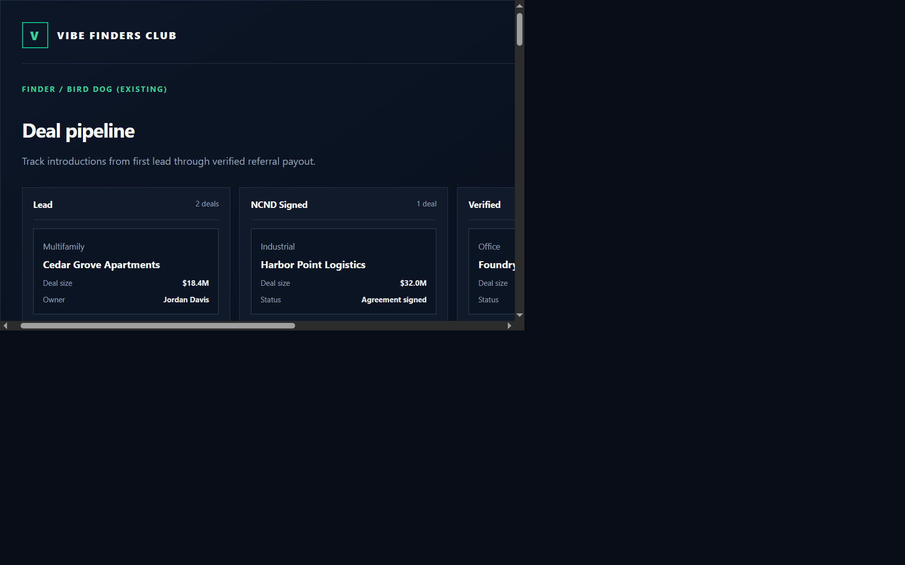
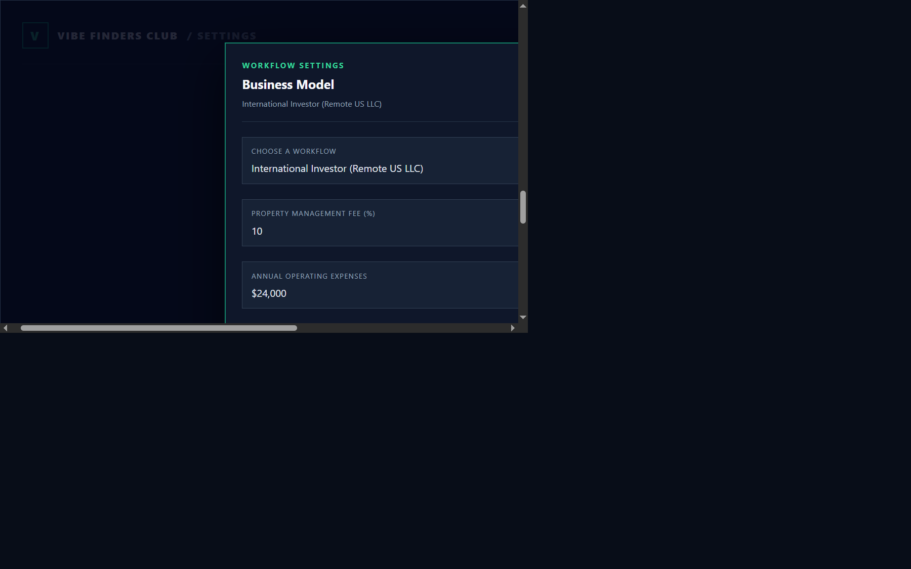
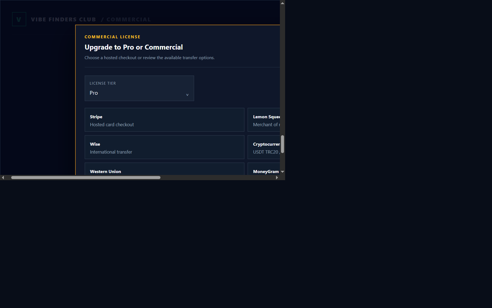

# Vibe Finders Club
> One repo. Four pipelines. Bring Your Own Keys.
A dual-licensed (AGPL-3.0 / Commercial) real estate deal sourcing, underwriting, and CRM matching engine. Run locally, self-host on Vercel, or deploy to your own stack.

## The 4 Pipelines (one repo, switchable)
| Pipeline | For | Stages |
|---|---|---|
| Finder / NCND | Bird dogs, restricted regions | Lead → NCND Signed → Verified → Referral Payout |
| US Wholesaler | Domestic wholesalers | Lead → Analysis → Contract → Assignment → Closing |
| Licensed Agent | Agents | Lead → Pre-Listing → Active → Under Contract → Closed |
| Intl Investor | Remote US LLC holders | Lead → Underwriting → LLC → PM Handoff → Cash Flow |
## Underwriting & Analytics


Built-in 70% MAO calculator (70% × ARV − repairs) with synthetic-estimate rejection.
## Bring Your Own Key (BYOK)

You supply your own Supabase / OpenRouter / Resend / Make.com keys. Zero third-party cost on our side.
## Free vs Pro
| Feature | Free (AGPL-3.0) | Pro (Commercial) |
|---|---|---|
| Kanban + MAO calc + single-source scrape | ✅ | ✅ |
| Multi-source stealth scrape (Scrapling) | — | ✅ |
| AI triage + cloud sync + email dispatch | — | ✅ |
| Commercial / white-label rights | — | ✅ |

## Quick Start
```bash
git clone https://github.com/ekoni-vibe/vibe-finders-club.git
cd vibe-finders-club && npm install
cp .env.example .env   # add your keys
node pipeline-agent.js --scrape && npm run dev
```
## License
Dual-licensed: AGPL-3.0-only OR LicenseRef-Commercial (see LICENSE + COMMERCIAL-LICENSE.md). AGPL permits commercial use under its terms; the paid license is an alternative for proprietary distribution.
## Sponsorship / Contributing
[](https://github.com/sponsors/ekoni-vibe) — see CONTRIBUTING.md.
