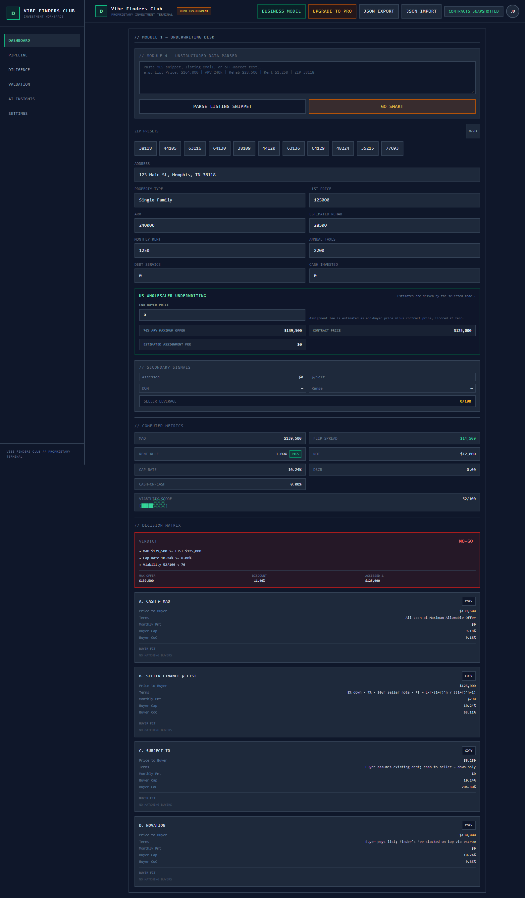
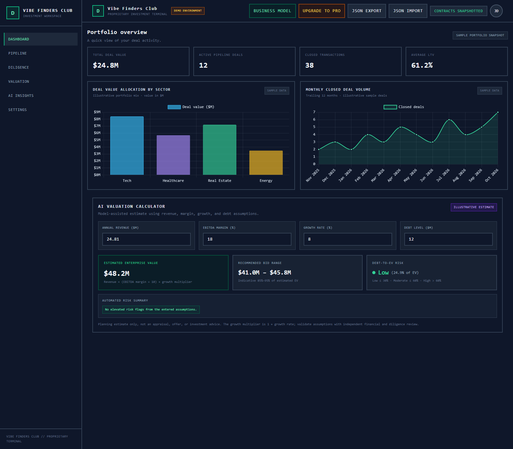

# Vibe Finders Club
> One repo. Four pipelines. Bring Your Own Keys.

A dual-licensed (AGPL-3.0 / Commercial) real estate deal sourcing, underwriting, and CRM matching engine.


## The 4 Pipelines (Switchable)
| Pipeline | Target User | Stages |
|---|---|---|
| Finder / NCND | Bird dogs, restricted regions | Lead → NCND Signed → Verified → Referral Payout |
| US Wholesaler | Domestic wholesalers | Lead → Analysis → Contract → Assignment → Closing |
| Licensed Agent | Real estate agents | Lead → Pre-Listing → Active → Under Contract → Closed |
| Intl Investor | Remote US LLC holders | Lead → Underwriting → LLC → PM Handoff → Cash Flow |

## Underwriting & Analytics



Built-in 70% MAO calculator (70% × ARV − repairs) with synthetic-estimate rejection.

## Bring Your Own Key (BYOK)


Configure your own Supabase, OpenRouter, Resend, and Make.com credentials in `.env` using `.env.example`. The settings image is an illustrative mock; the current web UI does not provide an API-key settings modal. Use your own provider accounts and review their pricing and terms.

## Pro & Commercial User Workflow
1. **Evaluate**: Use the AGPL-3.0 core for personal, open-source, or commercial projects, subject to the AGPL's terms. Commercial use alone does not require a paid license.
2. **Upgrade**: For proprietary, closed-source, or SaaS use where you do not want to comply with the AGPL's applicable obligations, contact [your-email@example.com] to discuss a Commercial License Exception.
3. **Activate**: Commercial terms, any license key, and any separate Pro repository or Docker image are provided only if specified in a written agreement. This repository does not include a license-key service or a separate Pro branch/image.
4. **Deploy**: Configure `.env` with your own API keys and deploy to Vercel or your private server.

## Free vs Pro
| Feature | Free (AGPL-3.0) | Pro (Commercial) |
|---|---|---|
| Kanban + MAO calc + configured public-source scraping | Included in this repository | Included if covered by the written agreement |
| Multi-source stealth scrape (Scrapling) | Not included in this repository | Not included in this repository; availability must be confirmed separately |
| AI triage + cloud sync + email dispatch | Repository modules are available under AGPL-3.0 terms | Alternative commercial terms only if specified in the written agreement |
| Commercial / white-label rights | Commercial use is permitted subject to AGPL-3.0 terms | Alternative proprietary/white-label terms by written agreement |


Checkout methods shown are example configuration options. Keep placeholders in the tracked example; use private server-side configuration for credentials and share real receiving details only through an appropriate secure channel.

## Monetization & Sponsorship

The project supports flexible global payment methods to accommodate customers across regions. Chapa is included for local Ethiopian users, with Telebirr, CBE, or Dashen Bank payment options subject to provider availability. International users can request Payoneer invoice details or use USDT on the TRON (TRC20) network. Lemon Squeezy is also listed as a global merchant-of-record checkout option and may require a foreign entity.

These are configuration examples, not active payment integrations. Keep API credentials in server-side environment variables (including `CHAPA_SECRET_KEY` and `LEMON_SQUEEZY_API_KEY`); do not place secrets, private keys, or recovery phrases in browser code or tracked files. Confirm provider eligibility, fees, tax, and applicable local requirements before accepting payments. Public checkout links or wallet addresses should only be published after an intentional disclosure review.

## Quick Start
```bash
git clone https://github.com/ekoni-vibe/vibe-finders-club.git
cd vibe-finders-club && npm install
cp .env.example .env # add your keys
node pipeline-agent.js --scrape && npm run dev
```

## License
Dual-licensed: AGPL-3.0-only OR Commercial License Exception. See [LICENSE](./LICENSE) and [COMMERCIAL-LICENSE.md](./COMMERCIAL-LICENSE.md). AGPL-3.0 permits commercial use subject to its terms, including applicable source-availability requirements for modified network services; the commercial exception is an alternative for users who need different terms.

## Sponsorship
[](https://github.com/sponsors/ekoni-vibe)
